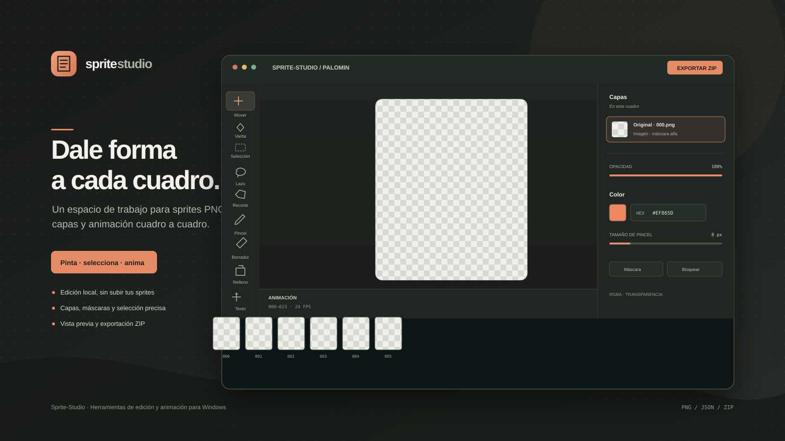

# Sprite-Studio



Editor local para trabajar con sprites PNG individuales, revisar animaciones cuadro a cuadro y exportar el conjunto conservando los nombres y las rutas relativas. El proyecto se llama **Sprite-Studio**; su repositorio privado de GitHub usa el nombre válido `Pixel-Studio`.

## Qué hace

Sprite-Studio está pensado para colecciones de imágenes con transparencia y un JSON de metadatos. Permite abrir una carpeta completa o varios archivos, trabajar en cuadros individuales, organizar capas, previsualizar secuencias y descargar el resultado como un ZIP. La edición sucede en el navegador: la aplicación no carga las imágenes a un servidor ni modifica los archivos originales.

Incluye un conjunto de ejemplo de Palomin con 113 cuadros PNG de 256 × 256 y el archivo `palomin_sprites.json`. Se puede abrir desde la pantalla inicial con **Explorar muestra Palomin**.

## Instalar y ejecutar en Windows

No hay instalador ni dependencias de npm. Se necesita Windows 10 u 11, Python 3 y una versión actual de Microsoft Edge o Google Chrome.

1. Descarga o copia la carpeta completa del proyecto en el equipo.
2. Instala Python 3 desde [python.org](https://www.python.org/downloads/windows/) si todavía no está instalado. En el instalador, activa la opción para añadir Python al `PATH`.
3. Abre la carpeta `Sprite-Studio` y haz doble clic en **Run Sprite-Studio.bat**.
4. El navegador abrirá `http://127.0.0.1:8765`. Mantén abierta la ventana del servidor mientras uses la aplicación.
5. Para detener el servidor, vuelve a esa ventana y pulsa **Ctrl+C**.

Si Windows no encuentra `py`, prueba `python` desde PowerShell:

```powershell
cd "$env:USERPROFILE\Downloads\Sprite-Studio"
python -m http.server 8765 --bind 127.0.0.1
```

Abre después `http://127.0.0.1:8765` en Edge o Chrome. Si el puerto 8765 ya está ocupado, detén el proceso que lo usa o cambia el puerto tanto en el comando como en `Run Sprite-Studio.bat`.

## Flujo de trabajo

1. Usa **Abrir carpeta** para cargar una carpeta de sprites, o **Explorar muestra Palomin** para probar el editor sin seleccionar archivos.
2. La aplicación busca archivos `.png` y, si está presente, el JSON de la carpeta. Los cuadros se ordenan por número de archivo.
3. Selecciona un cuadro en la línea de tiempo y edítalo en el lienzo. La barra izquierda agrupa las herramientas en las pestañas **Canvas**, **Select**, **Paint** y **Shape**; al elegir una categoría se activa una herramienta de ese grupo. Los paneles de herramientas, capas, propiedades e información se desplazan de forma independiente.
4. Usa **Exportar sprites** para descargar un ZIP con los PNG editados, sus rutas relativas y el JSON original cuando se haya cargado.

La exportación aplana las capas visibles de cada cuadro en su PNG final. No sobrescribe la carpeta de entrada. Guarda el ZIP descargado en el lugar que prefieras y descomprímelo para utilizar la secuencia en otra aplicación.

## Herramientas y funciones

- **Dibujo:** mover capas con Alt + arrastre al ampliar, arrastrar para desplazar el lienzo ampliado, mano para desplazar el lienzo, lápiz, pincel, borrador circular con tamaño ajustable, cubo de pintura, cuentagotas, línea, rectángulo y elipse con modos de contorno o relleno.
- **Selección:** rectangular, elíptica, lazo libre, lazo poligonal y lazo magnético, además de varita mágica con tolerancia. El borde activo se indica con una línea discontinua animada de alto contraste. Los rectángulos y las elipses dibujados, así como los trazos cerrados con lápiz o pincel, también pasan a ser selecciones. Las selecciones admiten antialias, desvanecimiento y modificadores para sumar o restar áreas.
- **Atajos de selección:** `Ctrl+A` selecciona todo el lienzo; `Ctrl+D` desactiva la selección; `Ctrl+Shift+D` la restaura; y `Ctrl+S` también restaura la última selección desactivada, según el flujo solicitado para Sprite-Studio.
- **Previsualización:** líneas, formas, trazos y contornos de selección muestran una guía temporal de alto contraste con bordes claros y oscuros para distinguirla sobre el tablero transparente y fondos claros u oscuros.
- **Limpieza y recorte:** herramienta de suavizado por región para eliminar motas pequeñas y suavizar bordes alfa; recorte a la región seleccionada; quitar o rellenar píxeles seleccionados.
- **Texto:** crea capas de texto con contenido, familia tipográfica, tamaño, color, alineación y estilos negrita o cursiva. El texto añadido se puede volver a editar mientras permanezca como su propia capa.
- **Capas:** añadir, seleccionar, reordenar mediante arrastre, cambiar visibilidad u opacidad, renombrar, bloquear, eliminar y editar máscaras alfa.
- **Transformaciones e historial:** rotar, voltear, deshacer y rehacer.
- **Navegación:** zoom del 10 % al 1600 %, controles de zoom, ajuste a la vista, rueda con Ctrl y atajos Ctrl + `+` / Ctrl + `-`; mano arrastrable y espacio + arrastre para panoramizar.
- **Acceso a herramientas:** pestañas compactas por función; los atajos de teclado también cambian a la categoría de la herramienta que activan.
- **Animación:** línea de tiempo con miniaturas, velocidad configurable, reproducción, secuencias y vista de onion skin. Para los cuadros Palomin se muestran las secuencias **Wave · 000–023** y **Thinking · 069–088**.
- **Metadatos y salida:** vista previa del JSON, detección de secuencias desde `animations` o `sequences` cuando sus rangos se expresan con `from/to`, `start/end` o listas de cuadros, y exportación a ZIP con rutas relativas.

## Tecnologías

| Tecnología | Uso |
|---|---|
| HTML5 | Estructura de la aplicación, paneles, controles y lienzo. |
| CSS3 | Diseño adaptable a escritorio, tema, estados de controles y cuadrícula de transparencia. |
| JavaScript moderno sin framework | Importación, edición, capas, selecciones, animación, historial y exportación. |
| Canvas 2D | Renderizado y manipulación de píxeles RGBA en memoria. |
| File API, Blob y URL Object URLs | Lectura local de PNG/JSON y descarga de resultados. |
| Python 3 `http.server` | Servidor estático local para ejecutar la aplicación y cargar los recursos de ejemplo. |
| SVG | Icono y portada vectorial del proyecto. |

El código de la aplicación no usa un backend, base de datos, framework, gestor de paquetes ni dependencias externas de JavaScript. El ZIP de salida se genera en el navegador con un empaquetador interno sin compresión adicional.

## Limitaciones conocidas

- El objetivo principal es el escritorio. La interfaz establece un ancho mínimo aproximado de 810 píxeles; en una ventana estrecha o un móvil puede requerir desplazamiento horizontal y los gestos táctiles no se han validado en un dispositivo físico.
- Solo se importan imágenes PNG; no hay compatibilidad PSD, SVG editable ni gestión de color profesional.
- Los cambios viven en la sesión actual del navegador hasta que se exportan. No hay guardado automático ni recuperación del historial al cerrar la pestaña.
- La edición de texto solo es editable para capas de texto creadas por el propio editor. Para cambiar texto que ya forma parte de los píxeles de un PNG, primero hay que borrar esa zona.
- La varita mágica selecciona píxeles contiguos según su tolerancia; no garantiza una segmentación semántica perfecta en imágenes con bordes complejos.
- Los archivos grandes pueden consumir mucha memoria porque las capas y selecciones se procesan en el navegador.

## Archivos principales

- `index.html`: estructura y controles.
- `styles.css`: estilos de la interfaz.
- `app.js`: herramientas y operaciones del editor.
- `public/samples/palomin/`: muestra PNG y metadatos JSON.
- `public/sprite-studio-cover.svg`: portada del proyecto.
- `public/sprite-studio-icon.svg`: icono del navegador.
- `Run Sprite-Studio.bat`: inicio local en Windows.
- `AUDIT.md`: alcance, comprobaciones y resultados de la auditoría funcional.
